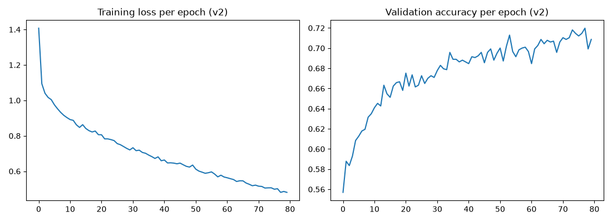
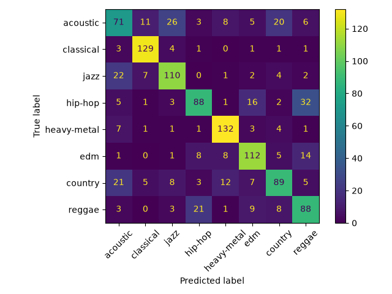

# Spotify Genre Classifier

I wanted to see if a model could guess a song's genre just from its audio features, without knowing the title, the artist, or anything about the song itself. So I built a neural network in PyTorch that takes 14 features (danceability, energy, tempo, valence, etc) and predicts one of 8 genres.

Final test accuracy was 0.701, which isn’t bad for a first model built from scratch. 

## Results

I compared a few models on the same data:

- Guessing the most common genre every time: 0.128 on test
- Logistic regression: 0.573 validation, 0.603 test
- My first neural net (smaller, 30 epochs): 0.656 validation
- My second neural net (bigger, 80 epochs): 0.720 validation, 0.701 test
- Random forest: 0.744 validation, 0.741 test

The neural net beat the linear model by a good amount, but was not able to beat the random forest. For tabular data like this, trees are naturally good at it. However, it was still worth building because I wanted to see how the training actually works, and I wrote the training loop myself instead of using a library that can do it for you.





## Things I noticed from the confusion matrix:

Classical and heavy metal were the easiest genres by far (F1 scores of 0.88 and 0.84). This makes sense beacuse classical is mostly instrumental and acoustic, and metal is very loud and high energy compared to the other genres. This is why their numbers look different from the rest.

The biggest confusion was hip-hop and reggae, as 53 songs got swapped between those two. This also makes sense, since they both have similar tempos and the vocals are rhythmic.

Acoustic was the worst genre (F1 of 0.50), which I expected after looking at the data. In this dataset "acoustic" is more of a playlist category than an actual sound, asit had ballads and pop songs and all kinds of stuff in it. There wasn't one clear pattern for the model to learn. One example of this is that there's a Zack Tabudlo song in the test set, "Asan Ka Na Ba", labeled acoustic, and the model predicted hip-hop because the song itself is more of a rhythmic pop/R&B kind of song. 

## About the data:

The dataset is the Spotify Tracks Dataset from Kaggle (by MaharshiPandya). The page says 125 genres but the file I downloaded actually had 114 genres with exactly 1000 songs each, so I went with what was in the file.

I only used 8 genres: acoustic, classical, jazz, hip-hop, heavy-metal, edm, country, and reggae. I picked ones that sound pretty different from each other.

Some cleaning I had to do:

- the same song showed up in multiple genre categories, so I removed duplicate track IDs (219 rows). If I didn't do that, the same song could end up in both the training set and the test set and the results wouldn't mean much.
- I didn't use popularity as a feature, since it's not really part of how a song sounds.
- In the end I had 7,781 songs, split into training (5,446), validation (1,167), and test (1,168), with each split keeping the same genre proportions.
- Features were scaled using only the training set's mean and standard deviation, then that same scaling was applied to the other sets.

## The model:

It's a simple MLP: 14 inputs, hidden layers of 256 and 128, then 8 outputs. ReLU activations, dropout of 0.2, Adam optimizer, cross entropy loss, batch size 64. I trained it for 80 epochs on my laptop using the GPU cores (MPS).

One thing I changed in the second version was saving the model whenever the validation accuracy improved, instead of just saving whatever it was at the end. The best epoch wasn't the last one (the last epoch got 0.709 and the saved one got 0.720), so that actually mattered.

The first version is in train\_model.py and the second in train\_model\_v2.py if you want to see what changed.

## How to run it:

```
python -m venv .venv
source .venv/bin/activate
pip install -r requirements.txt
```

Download dataset.csv from the Kaggle page and put it in a folder called data, then:

```
python explore_data.py
python prep_data.py
python baseline.py
python train_model_v2.py
python evaluate.py
```

## What I would do next:

- Try a learning rate schedule and more epochs to see if I can close the gap with the random forest
- Look more into the acoustic problem, maybe the model does better if that category is cleaner
- For a different project I want to try a CNN on actual audio/images instead of just features

Built with Python, PyTorch, pandas, scikit-learn, and matplotlib.